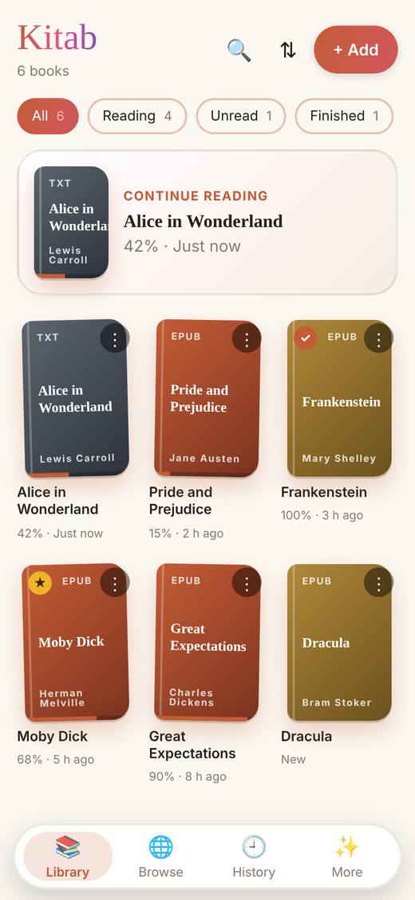
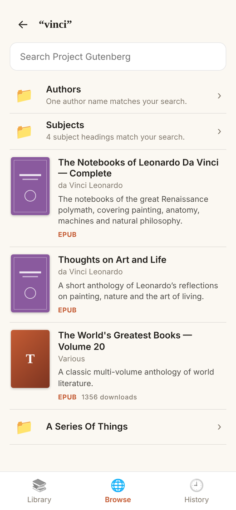
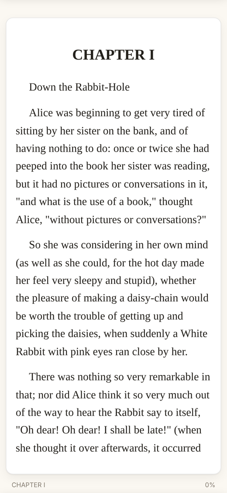
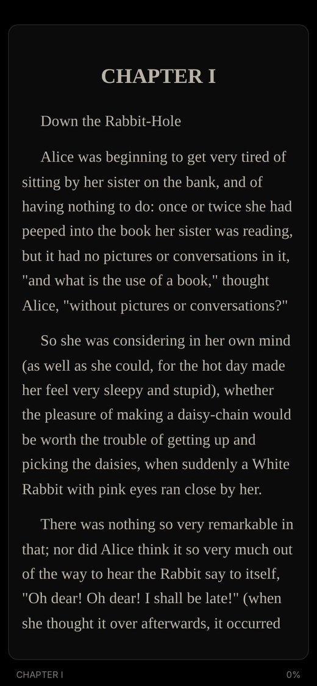
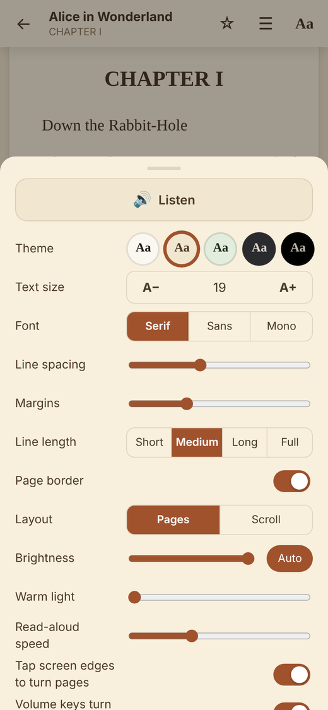

  

<h1 align="center">Kitab</h1>

<b>A free, fast book reader for Android.</b> 
EPUB · PDF · TXT · free public-domain library · scan old books into readable text

  

  Free · no ads · no account · Android 5.0 or newer

   
  On your computer? Scan this with your phone to download.

### Install in 3 taps

1. Tap **Download Kitab** above on your Android phone.
2. Open the downloaded file **Kitab.apk**.
3. If Android asks, allow **Install unknown apps** for your browser, then tap **Install**.

  
  
  
  
  

---

## How to use Kitab

**1. Find a book.**
Tap **Browse**, pick a catalog, search anything. Tap a cover, tap Download. It's yours, free.

**2. Or bring your own.**
Tap **+ Add** and pick any EPUB, PDF or TXT from your phone.

**3. Just read.**
Tap the edges to turn pages. Tap the middle for the menu. That's all.

**4. Make it feel right.**
Tap **Aa**. Pick a theme, a font, a size. Night mode is true black.

**5. Got an old scanned book?**
Tap **Aa**, then **Text only**. Kitab scans the whole book once, in the background, and saves the text in the app. Keep reading the page pictures meanwhile; each page turns into text by itself. Once a book is done, it's done: it opens instantly and is never scanned again.

**6. Eyes tired?**
Tap **Aa**, then **Listen**. Slide the 🐢—🐇 bar for the speed you like. Tap the screen to stop.

**7. Mark what matters.**
Press and hold a word and drag to select, then pick a colour (or underline, copy, add a note). Tap Look up for a word's meaning or a name on Wikipedia. This works on the original pages of a PDF too. Or tap the select button at the top and tap a sentence. Tap a highlight to change or remove it. Find them all under ☰ → Highlights.

**8. Come back any time.**
Kitab remembers where you stopped, in every book. Open the app, tap **Continue reading**.

**9. Rest your eyes.**
Every 30 minutes of reading, Kitab suggests a 20-second look into the distance. Skip it twice and it gently closes the book for a short rest. Change it in **More**.

**10. Make it look like you.**
Tap **More**: Funky or Classic style, six colours, five themes.

## Privacy and content

- Book pages are **protected from screenshots and screen recording** (switch it off in More if you like).
- The app's data is never included in device backups, and the reading screen cannot open other sites or run book scripts.
- The only permission is **Internet**, used for the Browse tab. No accounts, no ads, no analytics, nothing is sent anywhere except the catalog requests you make.
- Reading progress, bookmarks and scanned text stay on your phone.
- Kitab does **not** include or link to sources of pirated books. The built-in catalogs offer public-domain books only. Catalogs you add yourself are your responsibility; use libraries you have the right to read.

## How it's built

The UI is HTML/JS in [`assets/`](assets/), running in an Android WebView
([`MainActivity.java`](src/com/kitab/app/MainActivity.java)) that adds the native parts:
file picking, the private library folder, catalog requests and downloads ([`Http.java`](src/com/kitab/app/Http.java)), text-to-speech, brightness and volume keys.
Catalog browsing is [`opds.js`](assets/js/opds.js) and [`browse.js`](assets/js/browse.js).
Rendering uses [epub.js](https://github.com/futurepress/epub.js) (BSD-2), [PDF.js](https://mozilla.github.io/pdf.js/)
(Apache-2.0) and [JSZip](https://stuk.github.io/jszip/) (MIT), bundled in `assets/lib/`.

`./build.sh` builds the APK without the Android SDK or Gradle: it needs only a JDK 11+, Python 3 with
Pillow, `zip`, and two jars from Maven Central (the script downloads and checksums them):

- `javac` compiles against the Android 10 framework (`org.robolectric:android-all`)
- `dx` (`com.jakewharton.android.repackaged:dalvik-dx`) converts it to `classes.dex`
- [`tools/aapt_lite.py`](tools/aapt_lite.py) compiles the manifest and the icon resource table
- `jarsigner` signs it (APK signature v1; OCR is [Tesseract](https://github.com/naptha/tesseract.js) (Apache-2.0) bundled in `assets/lib/ocr/`; the app targets API 29, min API 21 / Android 5)

The signing key is generated on first build in `.tools/` and is not committed. Builds made with a
different key can't install over an existing copy, so to update the app you'd need to uninstall it
first (your reading progress is lost when you do). Set `KEYSTORE`/`STOREPASS` to keep one key across builds.

To work on the UI in a desktop browser, serve `assets/` with a `books/` folder next to `index.html`
(e.g. `python3 -m http.server`). Native-only features are stubbed out.
